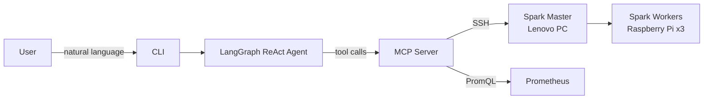

# Project Improvement Suggestions

Generated by Claude Code on 2026-03-23.

---

## Immediate Quality Fixes

Low effort, high signal — these should be addressed first.

### 1. Broken Import

`cluster_manager.py` imports `create_agent` from `langchain.agents` but the code uses `create_react_agent` from `langgraph.prebuilt`. This dead import would cause a runtime crash. Remove it.

### 2. Debug Print in Production Code

`mcp_tools.py` has a `print(f"{PROMETHEUS_URL}/api/v1/query")` statement left in `_prometheus_query`. Remove it or replace with `logging.debug(...)`.

### 3. Typo in `ls_filetree`

The returned dict uses `"dirctory"` instead of `"directory"`.

### 4. Fragile IP Parsing

`get_windows_host_ip()` parses `ip route show default` using `split()[2]`, which breaks on any routing table format variation. Use a regex instead:

```python
import re
match = re.search(r'via (\S+)', output)
if match:
    return match.group(1)
```

### 5. SSH Host Key Policy Comment

`AutoAddPolicy` disables host key verification. This is acceptable for a private home lab but should have an explicit comment so reviewers don't flag it as ignorance:

```python
# AutoAddPolicy is intentional — this client only targets a known private home lab network
client.set_missing_host_key_policy(paramiko.AutoAddPolicy())
```

### 6. `requires-python` Missing Lower Bound

`pyproject.toml` specifies `"<=3.13"` with no lower bound. Change to:

```toml
requires-python = ">=3.11,<=3.13"
```

---

## Medium Effort — High Resume Impact

### 7. Add a Test Suite

Zero tests is the most visible weakness to a technical reviewer. You don't need real cluster access — mock `_ssh_run` and `httpx.get`:

```
tests/
  test_mcp_tools.py        # mock SSH + Prometheus responses
  test_cluster_manager.py  # mock agent invocation
```

Even 5–10 unit tests with `pytest` + `unittest.mock` signals engineering discipline.

### 8. Pin Dependency Versions

Add a `dependencies` table to `pyproject.toml` with minimum version pins. The `environment.yml` currently has zero pins, which is a reproducibility risk:

```toml
[project]
dependencies = [
    "paramiko>=3.0",
    "fastmcp>=0.1",
    "langgraph>=0.2",
    "langchain-ollama>=0.1",
    "langchain-mcp-adapters>=0.1",
    "httpx>=0.27",
]
```

### 9. Replace `print()` with Structured Logging

Add `import logging` and use `logging.info/debug/error` throughout. This makes the project look production-aware and makes behavior configurable:

```python
logging.basicConfig(level=logging.INFO)
logger = logging.getLogger(__name__)

logger.debug("Querying Prometheus: %s", url)
```

### 10. Return Job Results to the LLM

The README acknowledges this gap. The simplest fix: after running `spark-submit` via SSH, SSH back in and `cat` the output file, then include it in the tool's return value. This closes the feedback loop and makes the demo dramatically more impressive — the LLM can actually summarize simulation results in natural language.

---

## Worthwhile Enhancements

Higher-effort changes that meaningfully elevate the project's grade.

### 11. Async SSH + HTTP

Replace `paramiko` with `asyncssh` and use `httpx.AsyncClient` instead of synchronous `httpx.get`. This makes the MCP server properly async and enables concurrent health checks across all cluster nodes simultaneously. This is the single biggest code quality signal for a senior engineer reviewer.

```python
import asyncssh
import httpx

async def _ssh_run(host: str, command: str) -> str:
    async with asyncssh.connect(host, username=SSH_USER, client_keys=[SSH_KEY_PATH]) as conn:
        result = await conn.run(command)
        return result.stdout or result.stderr

async def _prometheus_query(promql: str) -> list:
    async with httpx.AsyncClient() as client:
        response = await client.get(f"{PROMETHEUS_URL}/api/v1/query", params={"query": promql})
        ...
```

### 12. Structured Configuration with Pydantic

Replace the raw `os.getenv()` calls scattered across `mcp_tools.py` with a Pydantic `Settings` model. This validates all environment variables at startup and is a recognizable production pattern:

```python
from pydantic_settings import BaseSettings

class ClusterSettings(BaseSettings):
    spark_master_host: str
    spark_worker_hosts: str
    ssh_user: str
    ssh_key_path: str
    conda_path: str
    spark_job_dir: str

    model_config = {"env_file": ".env"}

settings = ClusterSettings()
```

### 13. CI Pipeline (GitHub Actions)

Add `.github/workflows/ci.yml` that runs on every push:

```yaml
name: CI
on: [push, pull_request]
jobs:
  test:
    runs-on: ubuntu-latest
    steps:
      - uses: actions/checkout@v4
      - uses: actions/setup-python@v5
        with:
          python-version: "3.11"
      - run: pip install -e ".[dev]"
      - run: pytest
      - run: ruff check .
      - run: mypy src/
```

This signals you know professional dev workflows even on a personal project.

### 14. Full Type Annotations

Add type hints to all functions, especially `_ssh_run`, `_prometheus_query`, and all tool functions. The codebase currently has none. Pair with a `mypy` step in CI for maximum effect:

```python
async def _ssh_run(host: str, command: str) -> str: ...
async def _prometheus_query(promql: str) -> list[dict]: ...
async def get_node_cpu_load() -> dict[str, float]: ...
```

### 15. Docker Compose for Local Development

Add a `docker-compose.yml` that spins up a mock Prometheus instance and a fake SSH target. This lets anyone clone the repo and run the tests without a physical cluster — dramatically lowering the barrier for a technical interviewer to evaluate it.

### 16. Makefile / Justfile

Simple top-level commands make the project feel immediately usable:

```makefile
install:
    pip install -e ".[dev]"

test:
    pytest tests/ -v

lint:
    ruff check src/

run:
    launch-manager
```

---

## Resume Narrative Enhancements

### 17. Architecture Diagram in README

Add a Mermaid diagram showing the full request flow. It's worth 1000 words to a reviewer who skims:



### 18. Demo Video / GIF

A 30-second terminal recording (using `asciinema` or a screen recorder exported to GIF) of submitting a fraud simulation job via natural language is extremely compelling in a GitHub README. Embed it at the top.

### 19. "Design Decisions" Section

Add a short section to the README explaining *why* you made key architectural choices. Reviewers reading resume projects want to see reasoning, not just what was built:

- Why MCP instead of direct function calls?
- Why LangGraph ReAct over a simple prompt loop?
- Why local Ollama over a cloud LLM API?
- Why a physical cluster over a cloud VM?

---

## Priority Order

| Priority | Item | Effort |
|---|---|---|
| 1 — Fix now | Broken import, debug print, typo, IP parsing | < 1 hour |
| 2 — This week | Tests, type hints, structured logging | 1–2 days |
| 3 — High impact | Return job results to LLM, architecture diagram, async SSH | 2–4 days |
| 4 — Polish | CI pipeline, Pydantic settings, Docker Compose, demo GIF | 1 week |

---

## Summary

The project's core concept — LLM-driven orchestration of a physical Spark cluster via MCP — is genuinely novel and impressive for a resume project. The enhancements above would take it from **"working prototype"** to **"production-aware engineering project"** in a reviewer's eyes. The physical cluster itself is a strong differentiator; making the software around it match that ambition is the goal.
